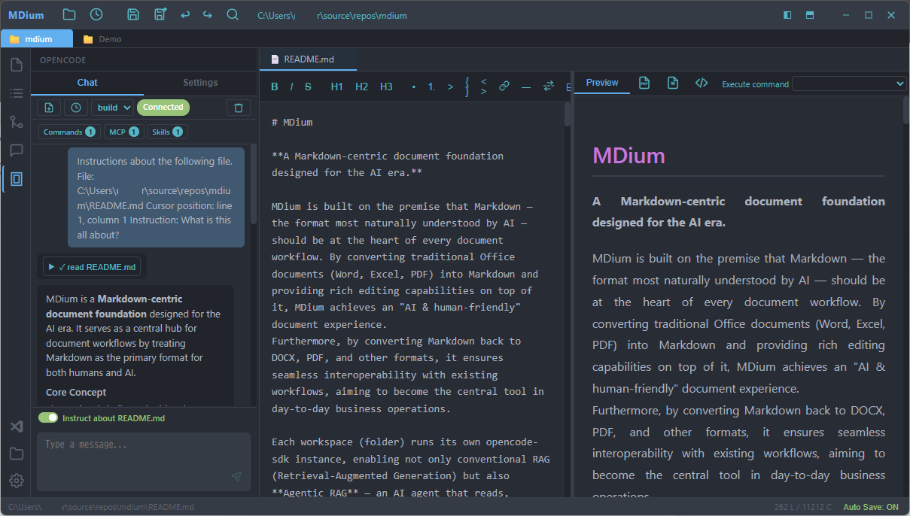
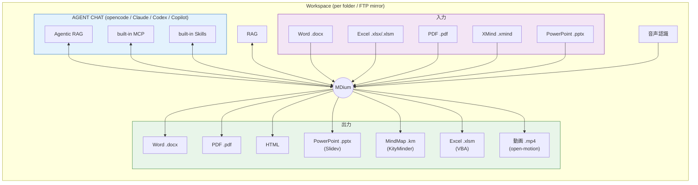

# MDium

**AI 時代のための、Markdown 中心のドキュメント基盤。**

MDium は、AI にとって最も自然なフォーマットである Markdown をあらゆるドキュメントワークフローの中心に据えるべきだという考えに基づいて構築されています。従来の Office ドキュメント（Word、Excel、PDF）を Markdown に変換し、その上にリッチな編集機能を提供することで「AI＆人間フレンドリー」を実現します。
さらに、Markdown を DOCX、PDF などのフォーマットに再変換することで既存のワークフローとのシームレスな相互運用を可能にし、日常業務の中核ツールとなることを目指しています。

各ワークスペース（フォルダ）は独自の opencode-sdk インスタンスを実行し、従来の RAG（検索拡張生成）だけでなく、**Agentic RAG** — フォルダ内のすべてのデータを読み取り、推論し、参照して、プロジェクトの知識に基づいたドキュメントを生成する AI エージェント — も可能にします。AGENT CHAT パネルでは opencode に加えて Claude Code、Codex、GitHub Copilot も同じ RAG インデックスを使えます。





[English README](README.md)

## 機能

### Markdown 編集

- エディタとプレビューの分割表示（リアルタイムプレビュー）
- GitHub Flavored Markdown（GFM）対応
- 数式表示（KaTeX）
- Mermaid ダイアグラム（フローチャート、シーケンス図、ER図、ガントチャート、クラス図、状態図、円グラフ）
- コードのシンタックスハイライト（18言語以上）
- クリップボードからの画像貼り付け（Ctrl+V）— プレビューダイアログ＆AI による代替テキスト自動生成
- 検索・置換（Ctrl+F / Ctrl+H）
- スクロール同期・自動保存
- ドキュメントアウトライン表示
- プレビューのダブルクリックでエディタの該当行へジャンプ
- HTML プレビュー・HTML 出力

### マルチフォーマット対応

- **Markdown**（.md）— メイン編集フォーマット
- **Office ドキュメント**（.docx, .xlsx, .xlsm, .pptx）— 閲覧・変換
- **CSV**（.csv）— テーブル表示（1 行目のヘッダ扱いを切替）
- **マインドマップ**（.km, .xmind）— インタラクティブなビジュアル編集
- **PDF**（.pdf）— 閲覧・Markdown への変換
- **画像**（.png, .jpg, .gif, .bmp, .svg, .webp 等）— プレビュー・キャンバス編集
- **コードファイル** — Monaco Editor によるシンタックスハイライト（拡張子で言語を自動判定）
- DOCX/Markdown の双方向変換
- Excel から Markdown への変換 — [xlsx2md](https://github.com/igapyon/xlsx2md) によるテーブル検出・ナラティブ抽出・画像/チャート/シェイプ・リッチテキスト対応
- PowerPoint から Markdown への変換（.pptx）— スライドプレビューと任意の AI 補強に対応
- Office/PDF → Markdown の一括変換（旧形式 .doc は Word 経由で .docx に変換、Windows + Word が必要）
- PDF / HTML エクスポート
- Slidev によるプレゼンテーション — Markdown からスライドをプレビュー・書き出し（初回に Slidev 環境を自動インストール）

### Excel VBA マクロチャット

- .xlsm / .xlam のタブはシートプレビューと、そのブックに紐づくマクロチャットに分割表示
- LLM が `vba_pull` でモジュールを `<ブック名>_assets/macros/` に展開し、`.bas` / `.cls` を編集して `vba_push` でブックへ書き戻す（標準・クラス・ドキュメントモジュールの更新、モジュールの追加・削除に対応）
- 書き戻しは自動で行われ、毎回 `<ブック名>.bak` を作成。ブックが Excel で開かれている間は書き戻しを拒否し、チャット上に警告を表示
- `vba_run` — 使い捨てコピー上で Excel COM によりマクロを実行し、指定セルの値を読み取って動作を検証（原本には触れない、1 指示あたり 6 回の実行予算、ファイル削除などの副作用があるマクロは実行前に承認ダイアログ）
- `xlsx_read` — ブックのセル値を読み取る補助ツール
- ビルトインスキル `vba-coding-conventions` / `vba-mdium-flow` が VBA の作法と「展開→編集→検証→書き戻し」の手順を LLM に教える（[docs/builtin-skills.ja.md](docs/builtin-skills.ja.md)）
- マクロ実行と Word 連携は Windows + Microsoft Office が必要

### AGENT CHAT

- opencode、Claude Code、Codex、GitHub Copilot をひとつのパネルのタブとして切替。フォルダごとにチャット状態を保持
- 各プロバイダの設定パネル（ルール、MCP サーバー、スキル、エージェント、ツール）を同じレイアウトで提供
- RAG（検索拡張生成）によるドキュメント Q&A と、設定可能な埋め込みモデルによるセマンティック検索（multilingual-e5-large、Ruri v3 等）。プロバイダタブの上にインデックスの状態と設定を表示
- `mdium-rag` MCP サーバーがアプリ内の RAG インデックスをすべてのプロバイダに公開（プロバイダごとに ON/OFF、Office ドキュメントの変換やインデックス更新はアプリ内で承認）
- `mdium-docs` MCP サーバーが Office/PDF コンバーターをエージェントから利用可能に
- ビルトイン MCP / ツール / スキルを接続時に自動導入（`rag_search`、`folder_glob`、`folder_grep`、`convert_office_docs`、`vba_*`、`xlsx_read` 等）
- opencode-sdk によるコンテンツ生成（エディタへの AI テキスト挿入）と使用量表示
- 複数 API プロバイダー対応：OpenAI、Anthropic、DeepSeek、Azure、Gemini、Grok、Groq、Ollama、カスタムエンドポイント
- チャットセッション管理・履歴保持
- UNC パス対応（ネットワークドライブ）
- 閉域環境向け：Hugging Face にアクセスできない環境では、埋め込みモデルの配置先フォルダと必要ファイルを案内し、手動配置で利用可能

### AI 画像生成

- ビルトイン MCP サーバー（Nano Banana 2）による Gemini ベースの AI 画像生成
- エディタ上でテキストプロンプトから画像を生成（右クリック → 挿入 → 画像 → MCP で生成）
- 生成画像は `images/` ディレクトリに自動保存され、Markdown として挿入

### 動画生成

- Markdown からシーン単位の動画を生成（[open-motion](https://github.com/jsongo/open-motion) を同梱）
- TTS ナレーション（VOICEVOX / OpenAI / Google）、字幕、BGM、トランジション・アニメーション、解像度の設定
- シーンごとの編集・ナレーション再生成、プレイヤーでの確認、エクスポート

### ワークフロー（WORKFLOWS パネル）

- タスクをカンバン・マトリクスで管理し、要件の取り込みから実装・レビュー・マージまでを多段ステージで実行
- 専用ウィンドウでの要件取り込み（対話→提案の確認→タスク化）
- 中断した実行の復旧、完了した作業のマージ/破棄
- フォージ（GitHub 等）の CLI と連携した Issue 追跡と結果の同期
- タスク添付（Office/PDF は Markdown 版も添付）、ワークフローが触れる範囲を説明する安全ガード

### フロー（実験的機能）

- 設定の「試験的な機能」で「フロー（汎用フローエンジン）」を ON にすると左バーにフローパネルが現れます
- `project.yaml` を持つ可搬なフロープロジェクト（セットアップ・テスト手順、署名検証、再利用可能な lib 部品）
- ノード種別：エージェント（1 ターンをガード付きで実行）、アクション（スクリーニング、git worktree、設計書、Issue 登録/クローズ、プロジェクトセットアップ、メトリクス比較）、Python（常駐 `mdium-worker`）、ループ、分岐、サブフロー
- ビジュアルエディタ：キャンバス編集、ノードパレット、属性フォーム、コメントとキー順を保つ YAML 分割表示、サブフローへのドリルダウンと選択ノードのサブフロー化
- テンプレート（`dev-workflow`、`improve-app`）、成果物プレビュー、ノードごとの実費記録

### 音声入力

- Whisper ベースの音声認識（whisper-small、whisper-large-v3-turbo、moonshine）
- Web Worker によるノンブロッキング処理
- エディタへの直接テキスト挿入
- モデルダウンロード（進捗表示付き）

### マインドマップエディタ

- ReactFlow を使用したインタラクティブなノードベース編集
- テーマ・レイアウトのカスタマイズ
- ノードへのハイパーリンク・画像挿入
- KM・XMind フォーマット対応

### ファイルエクスプローラー

- ファイルツリーエクスプローラー（フォルダナビゲーション）
- マルチフォルダワークスペース（タブ対応）
- ドラッグ＆ドロップによるファイル操作（ツリー内の移動/コピー）
- OS からのファイルインポート（システムファイルマネージャーからドラッグ）
- 切り取り/コピー/貼り付け操作（Ctrl+X / Ctrl+C / Ctrl+V）
- インラインファイル名変更（F2）
- デフォルトアプリケーションで開く
- ファイルタイプ別フィルタリング（画像, .docx, .xls\*, .pptx, .km/.xmind, .pdf）＋「すべて表示」モード
- ファイル監視・自動リフレッシュ
- コンテキストメニュー（名前変更、削除、コピー、切り取り、貼り付け、デフォルトアプリで開く）

### FTP / FTPS リモートフォルダ

- FTP / FTPS サーバー上のフォルダをローカルのミラーとして開き、他のフォルダと同じように編集
- 保存時にサーバーへ書き戻し。開くときにサーバー側の変更を確認し、同期間隔は設定可能。競合（両側で変更・削除）は一覧で確認
- 接続先の保存（パスワードは OS の資格情報マネージャーに保存）、自己署名証明書の許可
- Shift_JIS のファイル名に対応。ダウンロード中の進捗表示、選択項目のフルパス表示とコピー
- 左バーの FTP パネルから接続先・同期状態を管理

### 置換（マスキング）

- 置換前→置換後のルールをフォルダごとに管理し、有効/無効を切替（CSV でインポート/エクスポート）
- フォルダ内の .md ファイルを一括置換、または一括逆置換（後→前）で元に戻す
- 機密情報を伏せてから AI に渡し、結果を逆置換で復元する用途に

### Git ソースコントロール

- 左アクティビティバーに統合された Git パネル
- リポジトリ初期化（main ブランチ）
- ファイルのステージ/アンステージ
- メッセージ入力によるコミット
- AI によるコミットメッセージ自動生成
- リモートへのプッシュ / プル / リモート URL 管理
- ブランチ一覧・切り替え
- 変更の破棄（追跡済み・未追跡）

### 統合ターミナル

- xterm.js ベースのターミナル（PTY バックエンド）
- フォルダごとに複数のターミナルセッション
- Claude Code / Codex / GitHub Copilot の CLI をワンクリックで起動

### 公開

- Zenn 記事の作成・プレビュー（Zenn 記法対応）・公開（[docs/zenn-workflow.ja.md](docs/zenn-workflow.ja.md)）
- Medium への下書き投稿（[docs/medium-publish.md](docs/medium-publish.md)）

### テーマ＆カスタマイズ

- 複数のビルトインテーマ（ライト/ダーク）
- フォント、カラー、レイアウトのカスタマイズ
- 外部ツールとのテーマ同期
- 日本語/英語 UI

## はじめに

### 前提条件

- [Node.js](https://nodejs.org/)（v18 以上）
- [Rust](https://www.rust-lang.org/tools/install)
- npm
- 任意：[uv](https://docs.astral.sh/uv/)（フローの Python ノード用）、Microsoft Office（VBA マクロ実行・.doc 変換用、Windows）

### インストール

```bash
git clone https://github.com/straygizmo/mdium.git
cd mdium
npm install
```

### 開発

```bash
# Vite 開発サーバーの起動
npm run dev

# Tauri デスクトップアプリを開発モードで起動
npm run tauri dev
```

### ビルド

```bash
# プロダクションビルド
npm run build

# 配布用デスクトップアプリの作成
npm run tauri build
```

### テスト

```bash
npm run test          # テストを1回実行
npm run test:watch    # ウォッチモード
```

## キーボードショートカット

キーボードショートカットの一覧は [docs/keyboard-shortcuts.ja.md](docs/keyboard-shortcuts.ja.md) を参照してください。

## リリースノート

各バージョンの変更点は [release_notes/](release_notes/) を参照してください。

## プロジェクト構成

```
mdium/
├── src/
│   ├── app/               # メインアプリ、ツールバー、タブ、ステータスバー
│   ├── features/          # 機能モジュール
│   │   ├── agent-chat/    # AGENT CHAT パネル（プロバイダタブ、RAG インデックス）
│   │   ├── ai/            # AI 生成
│   │   ├── claude-config/ # Claude Code のチャットと設定
│   │   ├── codex-config/  # Codex の設定
│   │   ├── copilot-config/ # GitHub Copilot の設定
│   │   ├── code-editor/   # Monaco コードエディタ
│   │   ├── editor/        # Markdown エディタ
│   │   ├── export/        # DOCX/PDF/HTML エクスポート、Office 変換
│   │   ├── file-tree/     # ファイルエクスプローラー＆左パネル
│   │   ├── flow/          # フローエンジンの UI とエディタ
│   │   ├── git/           # Git ソースコントロールパネル
│   │   ├── image/         # 画像キャンバスエディタ
│   │   ├── intake/        # 要件取り込みウィンドウ
│   │   ├── medium/        # Medium 投稿
│   │   ├── mindmap/       # マインドマップエディタ
│   │   ├── opencode-config/ # opencode チャット、設定、ビルトインツール/スキル
│   │   ├── preview/       # Markdown/Office プレビュー、VBA マクロチャット
│   │   ├── rag/           # RAG インデックスのジョブとストア
│   │   ├── remote/        # FTP/FTPS ミラー
│   │   ├── replacement/   # 置換（マスキング）パネル
│   │   ├── search/        # 検索/置換
│   │   ├── settings/      # 設定ダイアログ
│   │   ├── speech/        # 音声入力
│   │   ├── table/         # テーブルエディタ
│   │   ├── terminal/      # 統合ターミナル
│   │   ├── video/         # 動画生成
│   │   ├── workflow/      # WORKFLOWS パネル
│   │   └── zenn/          # Zenn プラットフォーム対応
│   ├── shared/            # 型定義、フック、ユーティリティ、テーマ、i18n
│   └── stores/            # Zustand ストア
├── src-tauri/             # Tauri/Rust バックエンド
│   ├── crates/flow-core/  # フローエンジン（Tauri 非依存のクレート）
│   └── src/commands/      # バックエンドコマンド（ファイル、AI、PTY、Git、RAG、音声、MCP、VBA、FTP、フロー、動画）
├── python/mdium-worker/   # フローの Python ノードを実行する常駐ワーカー
├── resources/             # サイドカー（agent-runner、claude-sidecar）、MCP サーバー（mdium-rag、mdium-docs）、Slidev/動画環境、フローテンプレート
├── .opencode/             # ビルトインのカスタムツール定義（opencode に自動導入）
├── docs/                  # ショートカット、ビルトインスキル、Zenn/Medium の手順
├── release_notes/         # リリースノート
├── public/                # 静的アセット・テーマファイル
└── scripts/               # ビルド・インポートスクリプト
```

## クレジット

MDium は多くの優れたオープンソースプロジェクトの上に構築されています。特に以下のプロジェクトに感謝します：

| プロジェクト | 説明 |
| ------------ | ---- |
| [opencode](https://github.com/nicepkg/opencode) | MDium のチャット、MCP サーバー、Agentic RAG 機能を支える AI コーディングツール |
| [Slidev](https://github.com/slidevjs/slidev) | Markdown から PPTX へのエクスポートに使用するプレゼンテーションエンジン |
| [open-motion](https://github.com/jsongo/open-motion) | Markdown から動画生成を実現するプログラマティックビデオエンジン |
| [Tauri](https://github.com/tauri-apps/tauri) | ネイティブシェルを提供するデスクトップアプリケーションフレームワーク |
| [React](https://github.com/facebook/react) | フロントエンド全体を支える UI ライブラリ |
| [Vite](https://github.com/vitejs/vite) | ビルドツール・開発サーバー |
| [Monaco Editor](https://github.com/microsoft/monaco-editor) | ソースファイル編集用コードエディタコンポーネント |
| [ReactFlow](https://github.com/xyflow/xyflow) | マインドマップエディタ用のノードベースグラフライブラリ |
| [KityMinder](https://github.com/nicepkg/kityminder) | マインドマップフォーマット（.km）のサポート |
| [xlsx2md](https://github.com/igapyon/xlsx2md) | テーブル検出・リッチテキスト抽出対応の Excel→Markdown コンバーター |
| [marked](https://github.com/markedjs/marked) / [remark](https://github.com/remarkjs/remark) | Markdown のパースと変換 |
| [KaTeX](https://github.com/KaTeX/KaTeX) | 数式レンダリング |
| [Mermaid](https://github.com/mermaid-js/mermaid) | テキスト定義からの図表・チャートレンダリング |
| [Fabric.js](https://github.com/fabricjs/fabric.js) | 画像エディタ用 HTML5 キャンバスライブラリ |
| [xterm.js](https://github.com/xtermjs/xterm.js) | 統合ターミナル用のターミナルエミュレータ |
| [Hugging Face Transformers.js](https://github.com/huggingface/transformers.js) | 音声認識・埋め込みモデル用の ML 推論 |
| [Tesseract.js](https://github.com/naptha/tesseract.js) | 画像テキスト認識用 OCR エンジン |
| [Zustand](https://github.com/pmndrs/zustand) | 軽量な状態管理 |
| [mammoth](https://github.com/mwilliamson/mammoth.js) / [docx](https://github.com/dolanmiu/docx) | Word ドキュメントの読み書き |
| [highlight.js](https://github.com/highlightjs/highlight.js) | コードブロックのシンタックスハイライト |

…その他 `package.json` および `Cargo.toml` に記載されているすべてのライブラリに感謝します。

## ライセンス

[MIT](LICENSE) - Copyright (c) 2025 straygizmo
