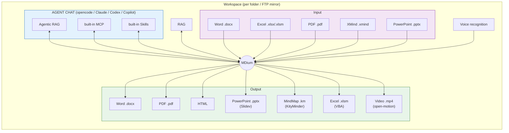

# MDium

**A Markdown-centric document foundation designed for the AI era.**

MDium is built on the premise that Markdown — the format most naturally understood by AI — should be at the heart of every document workflow. By converting traditional Office documents (Word, Excel, PDF) into Markdown and providing rich editing capabilities on top of it, MDium achieves an "AI & human-friendly" document experience.
Furthermore, by converting Markdown back to DOCX, PDF, and other formats, it ensures seamless interoperability with existing workflows, aiming to become the central tool in day-to-day business operations.

Each workspace (folder) runs its own opencode-sdk instance, enabling not only conventional RAG (Retrieval-Augmented Generation) but also **Agentic RAG** — an AI agent that reads, reasons over, and references all data within a folder to generate documents contextually grounded in your project's knowledge. The AGENT CHAT panel lets Claude Code, Codex and GitHub Copilot use the same RAG index alongside opencode.




[日本語版 README](README.ja.md)

## Features

### Markdown Editing

- Split-pane editor with real-time preview
- GitHub Flavored Markdown (GFM) support
- Mathematical expressions (KaTeX)
- Mermaid diagrams (flowcharts, sequence, ER, Gantt, class, state, pie)
- Code syntax highlighting (18+ languages)
- Image paste from clipboard (Ctrl+V) with preview dialog and AI-powered alt text generation
- Search and replace (Ctrl+F / Ctrl+H)
- Scroll synchronization and auto-save
- Document outline view
- Double-click in the preview to jump to the matching editor line
- HTML preview and HTML export

### Multi-Format Document Support

- **Markdown** (.md) — primary editing format
- **Office documents** (.docx, .xlsx, .xlsm, .pptx) — viewing and conversion
- **CSV** (.csv) — table view with a header-row toggle
- **Mindmaps** (.km, .xmind) — interactive visual editing
- **PDF** (.pdf) — viewing and conversion to Markdown
- **Images** (.png, .jpg, .gif, .bmp, .svg, .webp, etc.) — preview and canvas editing
- **Code files** — Monaco Editor with syntax highlighting and language auto-detection by extension
- Bidirectional DOCX/Markdown conversion
- Excel to Markdown conversion powered by [xlsx2md](https://github.com/igapyon/xlsx2md) (table detection, narrative extraction, images/charts/shapes, rich text)
- PowerPoint to Markdown conversion (.pptx) with slide preview and optional AI enrichment
- Batch Office/PDF to Markdown conversion (legacy .doc files are converted to .docx through Word; requires Windows + Word)
- Export to PDF and HTML
- Slidev presentations — preview and export slides from Markdown (the Slidev environment is installed on first use)

### Excel VBA Macro Chat

- .xlsm / .xlam tabs split into a sheet preview and a macro chat bound to that workbook
- The LLM extracts modules with `vba_pull` into `<workbook>_assets/macros/`, edits the `.bas` / `.cls` files and writes them back with `vba_push` (updates standard, class and document modules; adds and removes modules)
- Write-back happens automatically and creates `<workbook>.bak` every time. While the workbook is open in Excel the push is refused and the chat shows a warning
- `vba_run` — runs macros on a disposable copy through Excel COM and reads back the requested cells to verify behaviour (the original is never touched; 6 runs per instruction; macros with side effects such as file deletion need approval in a dialog first)
- `xlsx_read` — helper tool that reads cell values from a workbook
- Built-in skills `vba-coding-conventions` and `vba-mdium-flow` teach the LLM VBA pitfalls and the pull → edit → verify → push loop (see [docs/builtin-skills.ja.md](docs/builtin-skills.ja.md))
- Macro execution and the Word integration require Windows + Microsoft Office

### AGENT CHAT

- opencode, Claude Code, Codex and GitHub Copilot as tabs in one panel, with per-folder chat state
- Settings panels for every provider (rules, MCP servers, skills, agents, tools) in the same layout
- RAG (Retrieval-Augmented Generation) for document Q&A and semantic search with configurable embedding models (multilingual-e5-large, Ruri v3, etc.); an index strip above the provider tabs shows status and settings
- `mdium-rag` MCP server exposes the in-app RAG index to every provider (per-provider toggle; Office conversion and index updates are approved inside the app)
- `mdium-docs` MCP server shares the Office/PDF converters with agents
- Built-in MCP servers, tools and skills are installed automatically on connect (`rag_search`, `folder_glob`, `folder_grep`, `convert_office_docs`, `vba_*`, `xlsx_read`, …)
- Content generation via opencode-sdk (insert AI-generated text into the editor) with usage display
- Multiple API providers: OpenAI, Anthropic, DeepSeek, Azure, Gemini, Grok, Groq, Ollama, custom endpoints
- Chat session management with history persistence
- UNC path support for network drives
- Offline-friendly: where Hugging Face is not reachable, the app names the folder and files so embedding models can be placed manually

### AI Image Generation

- Built-in MCP server (Nano Banana 2) for AI image generation powered by Gemini
- Generate images from text prompts directly in the editor (right-click → Insert → Image → Generate with MCP)
- Generated images are automatically saved to the `images/` directory and inserted as Markdown

### Video Generation

- Generate scene-based videos from Markdown ([open-motion](https://github.com/jsongo/open-motion) is bundled)
- TTS narration (VOICEVOX / OpenAI / Google), captions, BGM, transitions and animations, resolution settings
- Per-scene editing and narration regeneration, in-app player, export

### Workflows (WORKFLOWS panel)

- Kanban and matrix views for tasks, run as multi-stage pipelines from requirement intake through implementation, review and merge
- Requirement intake in a dedicated window: converse, review proposals, then finalize into a task
- Recovery of interrupted runs; merge or discard finished work
- Issue tracking through the forge's CLI (GitHub etc.) with stage results synced back
- Task attachments (Office/PDF files also attached as Markdown) and a safety guard that explains what the workflow may touch

### Flows (experimental)

- Turn on "Flows (generic flow engine)" under "Experimental features" in Settings to show the Flow panel in the activity bar
- Portable flow projects with `project.yaml` (setup and test steps, signature verification, reusable library parts)
- Node kinds: agent (one guarded turn), action (screening, git worktree, design doc, issue entry/close, project setup, metrics compare), Python (resident `mdium-worker`), loops, branches and sub-flows
- Visual editor: editable canvas, node palette, attribute forms, a YAML split view that preserves comments and key order, drill-down into sub-flows and extraction of selected nodes into a sub-flow
- Templates (`dev-workflow`, `improve-app`), artifact previews, actual cost recorded per node

### Speech-to-Text

- Whisper-based speech recognition (whisper-small, whisper-large-v3-turbo, moonshine)
- Non-blocking Web Worker processing
- Direct transcript insertion into editor
- Model download with progress tracking

### Mindmap Editor

- Interactive node-based editing powered by ReactFlow
- Theme and layout customization
- Hyperlink and image insertion in nodes
- KM and XMind format support

### File Explorer

- File tree explorer with folder navigation
- Multi-folder workspace with tab support
- Drag-and-drop file operations (move/copy within tree)
- OS-to-tree file import (drag from system file manager)
- Cut/Copy/Paste operations (Ctrl+X / Ctrl+C / Ctrl+V)
- In-line file rename (F2)
- Open files in default application
- File filtering by type (images, .docx, .xls\*, .pptx, .km/.xmind, .pdf) with "show all" mode
- File watching and auto-refresh
- Context menu (rename, delete, copy, cut, paste, open in default app)

### FTP / FTPS Remote Folders

- Open a folder on an FTP / FTPS server as a local mirror and edit it like any other folder
- Saves are written back to the server; files are checked against the server when opened and the sync interval is configurable; conflicts (changed or deleted on both sides) are listed for review
- Saved connections (passwords stored in the OS credential manager) and optional acceptance of self-signed certificates
- Shift_JIS file names are decoded; download progress overlay; full path of the selected item with a copy button
- FTP panel in the activity bar for connections and sync status

### Replacement (Masking)

- Per-folder before → after rules that can be enabled individually and imported/exported as CSV
- Bulk replace across the folder's .md files, and bulk reverse replace (after → before) to restore
- Mask confidential terms before handing text to an AI, then restore the result with the reverse pass

### Git Source Control

- Integrated Git panel in left activity bar
- Repository initialization (with main branch)
- Staging and unstaging files
- Commit with message input
- AI-powered commit message generation
- Push / pull / remote URL management
- Branch listing and switching
- Discard changes (tracked and untracked)

### Integrated Terminal

- xterm.js-based terminal with PTY backend
- Multiple terminal sessions per folder
- One-click launchers for the Claude Code, Codex and GitHub Copilot CLIs

### Publishing

- Write, preview (Zenn syntax) and publish Zenn articles ([docs/zenn-workflow.md](docs/zenn-workflow.md))
- Publish drafts to Medium ([docs/medium-publish.md](docs/medium-publish.md))

### Themes & Customization

- Multiple built-in themes (light/dark)
- Customizable fonts, colors, and layout
- Theme synchronization with external tools
- Bilingual UI (English / Japanese)

## Getting Started

### Prerequisites

- [Node.js](https://nodejs.org/) (v18+)
- [Rust](https://www.rust-lang.org/tools/install)
- npm
- Optional: [uv](https://docs.astral.sh/uv/) for Python flow nodes; Microsoft Office on Windows for VBA macro runs and .doc conversion

### Installation

```bash
git clone https://github.com/straygizmo/mdium.git
cd mdium
npm install
```

### Development

```bash
# Start Vite dev server
npm run dev

# Run Tauri desktop app in dev mode
npm run tauri dev
```

### Build

```bash
# Build for production
npm run build

# Create distributable desktop app
npm run tauri build
```

### Testing

```bash
npm run test          # Run tests once
npm run test:watch    # Watch mode
```

## Keyboard Shortcuts

See [docs/keyboard-shortcuts.md](docs/keyboard-shortcuts.md) for the full list of keyboard shortcuts.

## Release Notes

See [release_notes/](release_notes/) for the changes in each version.

## Project Structure

```
mdium/
├── src/
│   ├── app/               # Main app component, toolbar, tabs, status bar
│   ├── features/          # Feature modules
│   │   ├── agent-chat/    # AGENT CHAT panel (provider tabs, RAG index strip)
│   │   ├── ai/            # AI generation
│   │   ├── claude-config/ # Claude Code chat and settings
│   │   ├── codex-config/  # Codex settings
│   │   ├── copilot-config/ # GitHub Copilot settings
│   │   ├── code-editor/   # Monaco code editor
│   │   ├── editor/        # Markdown editor
│   │   ├── export/        # DOCX/PDF/HTML export and Office conversion
│   │   ├── file-tree/     # File explorer & left panel
│   │   ├── flow/          # Flow engine UI and editor
│   │   ├── git/           # Git source control panel
│   │   ├── image/         # Image canvas editor
│   │   ├── intake/        # Requirement intake window
│   │   ├── medium/        # Medium publishing
│   │   ├── mindmap/       # Mindmap editor
│   │   ├── opencode-config/ # opencode chat, settings, built-in tools/skills
│   │   ├── preview/       # Markdown/Office preview, VBA macro chat
│   │   ├── rag/           # RAG index jobs and store
│   │   ├── remote/        # FTP/FTPS mirrors
│   │   ├── replacement/   # Replacement (masking) panel
│   │   ├── search/        # Find/Replace
│   │   ├── settings/      # Settings dialog
│   │   ├── speech/        # Speech-to-text
│   │   ├── table/         # Table editor
│   │   ├── terminal/      # Integrated terminal
│   │   ├── video/         # Video generation
│   │   ├── workflow/      # WORKFLOWS panel
│   │   └── zenn/          # Zenn platform support
│   ├── shared/            # Types, hooks, utilities, themes, i18n
│   └── stores/            # Zustand state stores
├── src-tauri/             # Tauri/Rust backend
│   ├── crates/flow-core/  # Flow engine (Tauri-independent crate)
│   └── src/commands/      # Backend commands (file, AI, PTY, git, RAG, speech, MCP, VBA, FTP, flow, video)
├── python/mdium-worker/   # Resident worker that runs Python flow nodes
├── resources/             # Sidecars (agent-runner, claude-sidecar), MCP servers (mdium-rag, mdium-docs), Slidev/video environments, flow templates
├── .opencode/             # Built-in custom tool definitions (installed into opencode automatically)
├── docs/                  # Shortcuts, built-in skills, Zenn/Medium guides
├── release_notes/         # Release notes
├── public/                # Static assets and theme files
└── scripts/               # Build and import scripts
```

## Credits

MDium is built on the shoulders of many outstanding open-source projects. Special thanks to:

| Project | Description |
| ------- | ----------- |
| [opencode](https://github.com/anomalyco/opencode) | AI coding tool that powers MDium's chat, MCP server, and agentic RAG capabilities |
| [Slidev](https://github.com/slidevjs/slidev) | Presentation slides engine used for Markdown-to-PPTX export |
| [open-motion](https://github.com/jsongo/open-motion) | Programmatic video engine enabling Markdown-to-video generation |
| [Tauri](https://github.com/tauri-apps/tauri) | Desktop application framework providing the native shell |
| [React](https://github.com/facebook/react) | UI library powering the entire frontend |
| [Vite](https://github.com/vitejs/vite) | Build tool and dev server |
| [Monaco Editor](https://github.com/microsoft/monaco-editor) | Code editor component for source file editing |
| [ReactFlow](https://github.com/xyflow/xyflow) | Node-based graph library for the mindmap editor |
| [KityMinder](https://github.com/nicepkg/kityminder) | Mindmap format support (.km) |
| [xlsx2md](https://github.com/igapyon/xlsx2md) | Excel-to-Markdown converter with table detection and rich text extraction |
| [marked](https://github.com/markedjs/marked) / [remark](https://github.com/remarkjs/remark) | Markdown parsing and transformation |
| [KaTeX](https://github.com/KaTeX/KaTeX) | Mathematical expression rendering |
| [Mermaid](https://github.com/mermaid-js/mermaid) | Diagram and chart rendering from text definitions |
| [Fabric.js](https://github.com/fabricjs/fabric.js) | HTML5 canvas library for the image editor |
| [xterm.js](https://github.com/xtermjs/xterm.js) | Terminal emulator for the integrated terminal |
| [Hugging Face Transformers.js](https://github.com/huggingface/transformers.js) | ML inference for speech-to-text and embedding models |
| [Tesseract.js](https://github.com/naptha/tesseract.js) | OCR engine for image text recognition |
| [Zustand](https://github.com/pmndrs/zustand) | Lightweight state management |
| [mammoth](https://github.com/mwilliamson/mammoth.js) / [docx](https://github.com/dolanmiu/docx) | Word document reading and writing |
| [highlight.js](https://github.com/highlightjs/highlight.js) | Syntax highlighting for code blocks |

…and all the other libraries listed in `package.json` and `Cargo.toml`.

## License

[MIT](LICENSE) - Copyright (c) 2025 straygizmo
